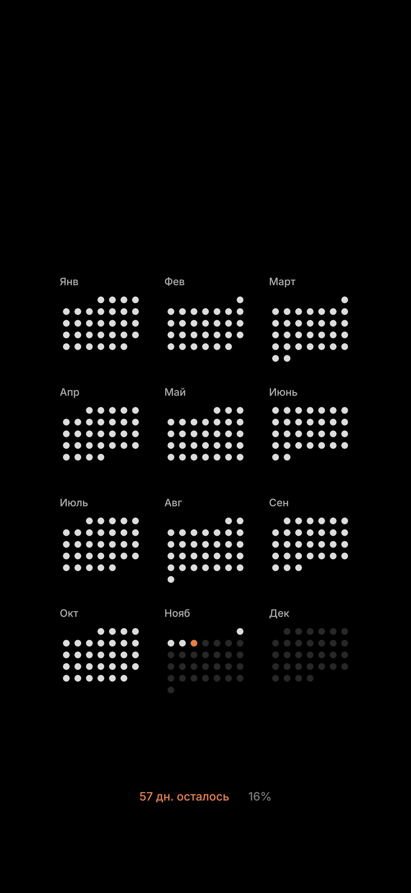

# Заставка: год точками

Картинка для экрана блокировки iPhone: 12 месяцев точками, прошедшие дни светлые, сегодня оранжевый, внизу сколько дней осталось до конца года и процент



## Как это работает

- Каждую ночь GitHub Actions запускает `wallpaper.py` и кладёт свежую `wallpaper.png` в этот репозиторий (в 00:17 по Сан-Паулу и запасной запуск в 02:47)
- Быстрая команда на iPhone в 04:00 скачивает картинку и ставит её на экран блокировки
- Сервер не нужен, всё бесплатно

## Ссылка для Быстрой команды

```
https://raw.githubusercontent.com/nikonbruh/wallpaper/main/wallpaper.png
```

В действии «Получить содержимое URL» вставить эту ссылку, следующее действие «Установить обои» остаётся как было

## Настройки

В `.github/workflows/wallpaper.yml`:

- `WALLPAPER_TZ`: часовой пояс, по нему считается «сегодня» (по умолчанию `America/Sao_Paulo`)
- `WALLPAPER_MODEL`: модель iPhone, список в `MODELS` в `wallpaper.py` (по умолчанию `iphone_16_pro_max`)

Цвета и раскладка в начале `wallpaper.py`

## Если картинка не обновилась

Вкладка Actions, workflow «Обновить заставку», кнопка Run workflow

## Локально

```
pip install -r requirements.txt
python wallpaper.py --date 2026-12-31 --out test.png
```

Шрифт Inter, лицензия SIL OFL 1.1 в `fonts/LICENSE.txt`
